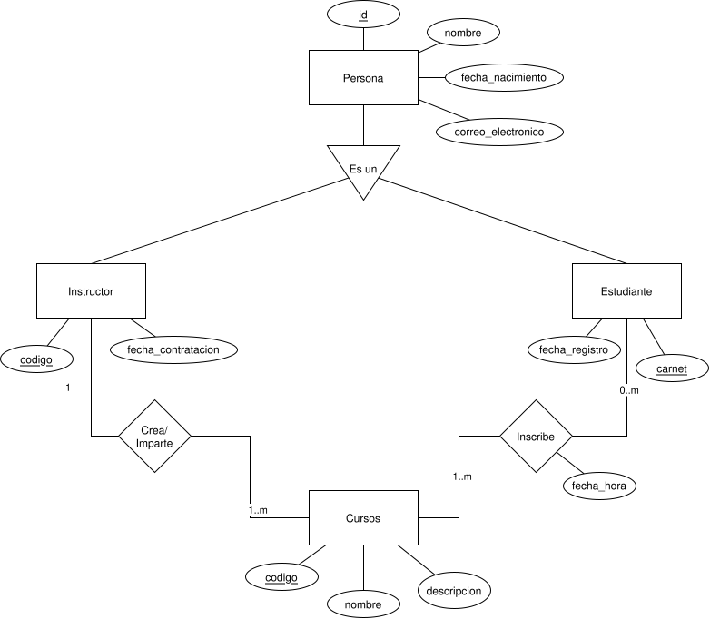
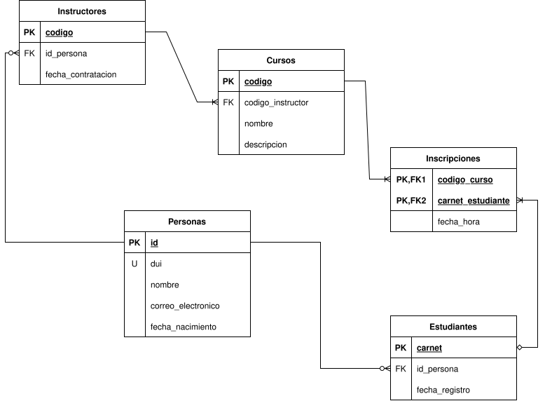
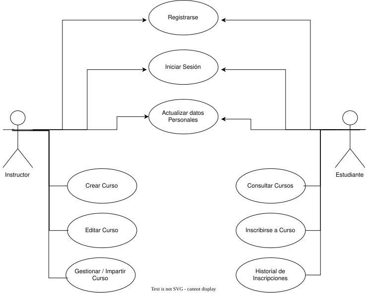

# API para una Plataforma de Cursos Online

Un instructor puede crear cursos. Un estudiante puede inscribirse en múltiples cursos.

La API debe gestionar la relación de inscripciones y permitir listar los cursos de un estudiante o los estudiantes de un curso

# Integrantes

| CARNET | CORREO | APELLIDOS | NOMBRES |
| --- | --- | --- | --- |
| PR17014 | pr17014@ues.edu.sv | Posada Reina | Manuel Abilio |
| CS12034 | cs12034@ues.edu.sv | Cambara Sandoval | Guillermo |
| GD14019 | gd14019@ues.edu.sv | Gámez Dueñas | Daniel Ernesto |

## Requerimientos

- Docker

### Inicializacion

Abrir terminal y correr el siguiente comando:

```batch|bash
docker compose up --build -d
```
Revisar base de datos en terminal:

```batch|bash
docker exec -it mysql_db_dev mysql -u root -p
```

## Diagramas:

### Entidad-Relacion
[](https://app.diagrams.net/#G1Zk41vk7w4nlJFcjxgWfQrw3sWo9-ktVV#%7B%22pageId%22%3A%22MpA_bfUj7DACWKivBm2_%22%7D)

### ER
[](https://app.diagrams.net/#G1Zk41vk7w4nlJFcjxgWfQrw3sWo9-ktVV#%7B%22pageId%22%3A%22zYdk7aZqAQoJcKxQO6y5%22%7D)

### Casos de Uso
[](https://app.diagrams.net/#G1Zk41vk7w4nlJFcjxgWfQrw3sWo9-ktVV#%7B%22pageId%22%3A%22GL8w39yK3QvlQB7dP-3l%22%7D)

## Despliegue en Kubernetes (local)

### Requisitos
- Docker Desktop con Kubernetes activado (Settings → Kubernetes → método **kubeadm**).
- `kubectl` instalado.

### Pasos

1. Construir la imagen de la API (el cluster usa la imagen local):

   ```powershell
   docker build -t cursos-api:local .
   ```

2. Crear el archivo de credenciales a partir del ejemplo y poner valores reales
   (usuario y contraseñas de la base de datos). Este archivo no se sube a Git.

   ```powershell
   copy k8s\secret.yaml.example k8s\secret.yaml
   ```

3. Aplicar los manifiestos:

   ```powershell
   kubectl apply -f k8s/
   ```

4. Verificar que ambos pods estén en `Running`. La API puede reiniciarse un par de
   veces al inicio mientras MySQL termina de arrancar.

   ```powershell
   kubectl get pods
   ```

5. Abrir la documentación de la API en el navegador:
   http://localhost:30080/swagger-ui/index.html

### Comandos útiles

```powershell
kubectl logs deployment/cursos-api --tail=50   # logs de la API
kubectl rollout restart deployment/cursos-api  # reiniciar la API tras reconstruir la imagen
kubectl delete -f k8s/                         # eliminar todo, incluida la base de datos
```